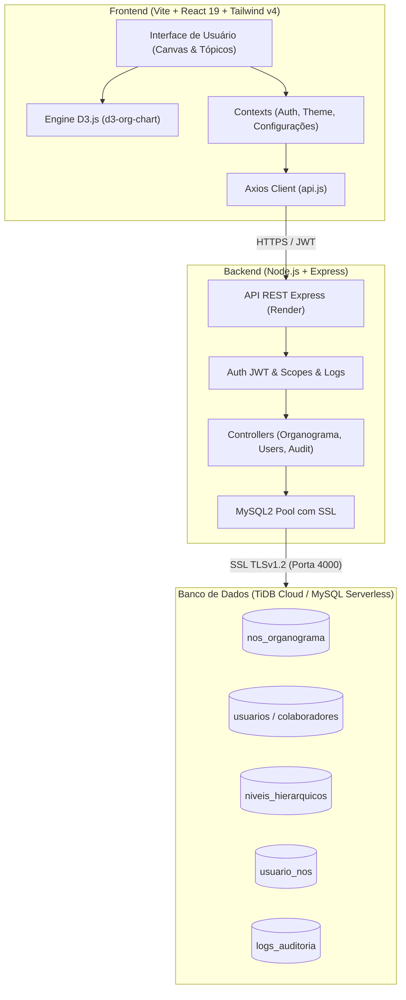

# Mapa de Manutenção e Arquitetura do Sistema
## JHE Engenharia & Consultores Associados — Organograma Corporativo v2.0

> Documento oficial de engenharia de software para consulta rápida, onboarding de desenvolvedores e guia de manutenção evolutiva do ecossistema Organograma Corporativo JHE.

---

## 1. Visão Geral da Arquitetura

O sistema é estruturado no modelo **Monorepo / Clean Architecture** em duas camadas principais integradas à nuvem:



* **Frontend:** SPA desenvolvida com **React 19**, **Vite**, **Tailwind CSS v4**, **D3.js** (`d3-org-chart`), **html-to-image** e **jsPDF**. Hospedagem: Vercel.
* **Backend:** API REST desenvolvida em **Node.js (ES Modules)** e **Express**, com autenticação JWT, pool de conexões com transações atômicas e middlewares de auditoria estrita. Hospedagem: Render.
* **Banco de Dados:** **TiDB Cloud** (banco distribuído compatível com MySQL 8.0), com replicação nativa, criptografia em trânsito (SSL/TLS CA cert) e integridade referencial.

---

## 2. Árvore de Diretórios Anotada

```text
Organograma_v2/
├── backend/
│   ├── controllers/
│   │   ├── auditController.js         # Filtros, paginação e exportação de auditoria
│   │   ├── authController.js          # Login corporativo, hash bcrypt e emissão de JWT
│   │   ├── configuracoesController.js # Configurações visuais e regras institucionais
│   │   ├── organogramaController.js   # CRUD da árvore, movimentações e transações
│   │   └── userController.js          # Gestão de usuários, senhas e múltiplos vínculos
│   ├── database/
│   │   └── database.js                # Conexão Pool mysql2 com SSL e helper withTransaction
│   ├── middlewares/
│   │   ├── authMiddleware.js          # Validação de token Bearer JWT
│   │   ├── authorizeScope.js          # RBAC (admin, gestor, visualizador)
│   │   └── errorMiddleware.js         # Handler centralizado de erros e respostas 404/500
│   ├── routes/
│   │   ├── auditRoutes.js             # Rotas /api/auditoria e logs
│   │   ├── authRoutes.js              # Rotas /api/auth (login, me, refresh)
│   │   ├── configuracoesRoutes.js     # Rotas /api/configuracoes
│   │   └── organogramaRoutes.js       # Rotas /api/organograma (nós, pessoas, movimentações)
│   ├── scripts/
│   │   ├── carga_incremental_colaboradores.js # Carga em lote idempotente via SQL/JSON
│   │   ├── create_config_table.js             # Migração para tabela de configurações
│   │   └── resetPasswords.js                  # Script utilitário para recuperação de senhas
│   ├── utils/
│   │   └── auditLogger.js             # Gravação assíncrona de logs na tabela logs_auditoria
│   ├── package.json                   # Dependências do backend (express, mysql2, etc.)
│   └── server.js                      # Entrypoint Express, CORS e inicialização de rotas
│
├── frontend/
│   ├── public/
│   │   ├── favicon.png                # Favicon institucional da JHE Engenharia
│   │   └── favicon.ico                # Fallback legado de favicon
│   ├── src/
│   │   ├── assets/                    # Logotipos oficiais (SVG) e ícones estáticos
│   │   ├── components/
│   │   │   ├── AuditLogsModal.jsx     # Modal de logs com sticky header e exportação PDF
│   │   │   ├── CanvasControls.jsx     # Barra flutuante de zoom, pan, lock e exportação
│   │   │   ├── MultiResponsavelInput.jsx # Input tag/chips com normalização de líderes
│   │   │   ├── Navbar.jsx             # Barra superior com busca global, perfil e modos
│   │   │   ├── NodeCard.jsx           # Componente React modular do cartão do organograma
│   │   │   ├── NodeDrawerEditor.jsx   # Gaveta lateral de edição avançada do setor/nó
│   │   │   ├── OrganogramaView.jsx    # Motor visual D3.js, layout 2 andares e exportação
│   │   │   ├── OrgNode.jsx            # Alias de re-exportação para compatibilidade
│   │   │   ├── PublicNodeDetailsCard.jsx # Ficha institucional do setor ao clicar no card
│   │   │   ├── QuickGuideModal.jsx    # Guia rápido com abas informativas e arquitetura
│   │   │   ├── TopicEditor.jsx        # Editor em lista hierárquica expansível com Drag & Drop
│   │   │   ├── TopicEditorView.jsx    # Wrapper do editor em tópicos com barra de ações
│   │   │   └── UserManagementModal.jsx # Painel administrativo de usuários e vínculos
│   │   ├── context/
│   │   │   ├── AuthContext.jsx        # Estado de autenticação, usuário logado e perfil
│   │   │   ├── ConfiguracoesContext.jsx # Regras de governança e estilos corporativos
│   │   │   └── ThemeContext.jsx       # Alternância Light Mode / Dark Mode persistente
│   │   ├── hooks/
│   │   │   ├── useIdleTimeout.js      # Logout automático por tempo de inatividade
│   │   │   └── useTheme.js            # Acesso simplificado ao estado do tema
│   │   ├── services/
│   │   │   └── api.js                 # Cliente Axios com interceptors JWT e resolução de URL
│   │   ├── styles/
│   │   │   └── organograma.css        # CSS global, tokens institucionais e correções D3
│   │   ├── utils/
│   │   │   ├── exportAuditPdf.js      # Gerador de relatórios tabulares em PDF
│   │   │   └── treeBuilder.js         # Normalizador de nós órfãos e ordenação determinística
│   │   ├── App.jsx                    # Componente raiz, estados globais e modais
│   │   ├── index.html                 # HTML raiz com fontes Inter e meta tags
│   │   └── main.jsx                   # Ponto de montagem React DOM
│   ├── package.json                   # Dependências do frontend (react, d3, lucide, etc.)
│   └── vite.config.js                 # Configurações do bundler Vite e proxies locais
│
├── mapa_manutencao.md                 # ESTE DOCUMENTO DE REFERÊNCIA RÁPIDA
└── package.json                       # Scripts globais do monorepo (npm run dev / build)
```

---

## 3. Tabela de Manutenção Rápida

| Desejo de Manutenção / Alteração | Arquivo(s) Responsável(is) | Trecho / Linha de Referência |
| :--- | :--- | :--- |
| **Ajustar largura ou altura dos cartões** | `frontend/src/components/OrganogramaView.jsx`<br>`frontend/src/components/NodeCard.jsx` | `CARD_WIDTH = 260;`<br>`CARD_HEIGHT = 154;`<br>`min-height: 154px;` |
| **Ajustar distância vertical/horizontal entre ramos** | `frontend/src/components/OrganogramaView.jsx` | `VERTICAL_GAP = 95;`<br>`HORIZONTAL_GAP = 45;`<br>`NEIGHBOUR_GAP = 60;` |
| **Ajustar espaçamento ou layout dos 2 andares sob o CEO** | `frontend/src/components/OrganogramaView.jsx` | `function organizarFilhosEmDoisAndares()`<br>`function calcularDeslocamentoVerticalDinamico()` |
| **Trocar cores do tema, cartões e Dark Mode** | `frontend/src/styles/organograma.css`<br>`frontend/src/components/OrganogramaView.jsx` | `:root` e `[data-theme="dark"]`<br>`getLevelAccentColor()` e gradientes inline no card |
| **Alterar dados do nó raiz inicial ou colapso padrão** | `frontend/src/App.jsx`<br>`frontend/src/components/OrganogramaView.jsx` | `INITIAL_NOS`<br>`.initialExpandLevel(0)` |
| **Corrigir ou calibrar exportação para PNG / SVG** | `frontend/src/components/OrganogramaView.jsx` | `handleExportCanvas(format)` com `toPng` / `toSvg` e cálculo de `bbox` |
| **Ajustar formato e proporção da prancha em PDF** | `frontend/src/components/OrganogramaView.jsx`<br>`frontend/src/utils/exportAuditPdf.js` | `new jsPDF({ orientation, unit: 'pt', format: [w, h] })` |
| **Adicionar novas instruções no Guia Rápido** | `frontend/src/components/QuickGuideModal.jsx` | Array `sections` (ex: `'tree-architecture'`, `'navegacao'`) |
| **Sincronizar novos colaboradores da planilha (Carga)** | `backend/scripts/carga_incremental_colaboradores.js` | `SENHA_PADRAO`, `cleanEmail()`, `NO_TRIAGEM_ID = 999` |
| **Ajustar cabeçalhos fixos (sticky) de tabelas** | `frontend/src/components/UserManagementModal.jsx`<br>`frontend/src/components/AuditLogsModal.jsx` | `sticky top-0 z-20 bg-slate-50 dark:bg-slate-900` |
| **Alterar regras de acesso por perfil (RBAC)** | `backend/middlewares/authorizeScope.js`<br>`frontend/src/context/AuthContext.jsx` | `canEditNode`, `isAdmin`, papéis `admin / gestor / visualizador` |
| **Alterar precedência hierárquica na ordenação de nós** | `frontend/src/utils/treeBuilder.js` | `SLUG_PRECEDENCE = { ceo: 1, oia: 2, staff: 3, diretoria: 4, ... }` |

---

## 4. Ciclo de Vida dos Estados e Renderização do Grafo

1. **Carregamento Inicial:**
   - O `App.jsx` dispara `fetchFlatNodesList()` através do serviço `api.js`.
   - A requisição atinge `GET /api/organograma/arvore` no backend (`organogramaController.js`).
   - A consulta SQL une `nos_organograma`, `niveis_hierarquicos` e faz agregações com `usuario_nos` e `usuarios` para listar os membros diretos e contagem da equipe.

2. **Normalização dos Dados:**
   - Os dados chegam ao frontend e passam pelo utilitário `buildAndSortOrgTree()` em `treeBuilder.js`.
   - Os nós são ordenados deterministicamente por precedência de nível (`SLUG_PRECEDENCE`) e sua ordem numérica.
   - O acumulado de subordinados (`total_equipe_acumulada`) é calculado recursivamente da base até a raiz.

3. **Injeção no Motor D3.js:**
   - O `OrganogramaView.jsx` instancia a classe `OrgChart()` de `d3-org-chart`.
   - O layout intercepta nós do nível superior aplicando `organizarFilhosEmDoisAndares()`, garantindo que:
     - **Linha 1:** Órgãos de Staff, OIA e Governança fiquem acima.
     - **Linha 2:** Diretorias Executivas e suas estruturas ramificadas fiquem abaixo sem colisão vertical.
   - O gerador customizado `diagonal(n, p)` desenha as conexões ortogonais estritas em formato de "T" invertido.

4. **Interatividade e Modais:**
   - Clicar no badge de contagem de membros abre o `teamPopover` desacoplado no DOM.
   - Clicar no corpo do card centraliza o nó com zoom suave e abre a ficha institucional (`PublicNodeDetailsCard.jsx`) ou gaveta de edição (`NodeDrawerEditor.jsx`) caso autenticado.

---

## 5. Comandos Úteis de Terminal

### 5.1. Execução em Desenvolvimento Local
Executa simultaneamente o backend (porta 3001) e o frontend (porta 5173):
```bash
# Na raiz do projeto
npm run dev
```

### 5.2. Compilação e Build de Produção
Valida types, bundler e minificação do frontend:
```bash
npm run build --workspace=frontend
```

### 5.3. Scripts de Carga e Manutenção de Dados
Execução manual de carga incremental de novos colaboradores:
```bash
# Certifique-se de configurar as variáveis no backend/.env antes
node backend/scripts/carga_incremental_colaboradores.js
```

### 5.4. Deploy e Controle de Versão
Fluxo seguro e padronizado de commit e sincronização com o repositório principal:
```bash
git add .
git commit -m "docs: adicionar comentarios explicativos no codigo e criar mapa_manutencao.md"
git push origin main
```
